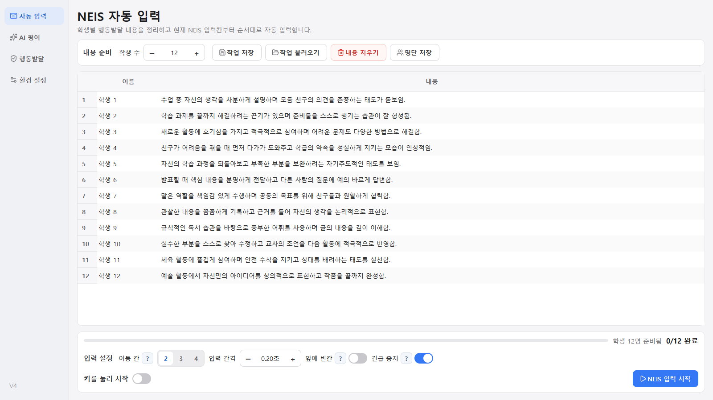

# NeisAutoInputV4

**초등학교 생활기록부 문장을 준비해 NEIS 화면에 순서대로 입력해 주는 Windows 프로그램**입니다.

교사가 직접 쓴 문장을 입력할 수도 있고, Gemini나 OpenAI로 **교과 평어**와 **행동특성 및 종합의견** 초안을 만든 뒤 입력할 수도 있습니다.



> [!IMPORTANT]
> 이 프로그램은 NEIS에 접속하거나 학생을 이름으로 찾지 않습니다. 선생님이 열어 둔 NEIS 화면의 **현재 입력칸**에 문장을 붙여 넣고, 정해 둔 횟수만큼 `Tab` 키를 눌러 다음 칸으로 넘어갈 뿐입니다. 저장 버튼도 누르지 않습니다. 입력 전에는 학생 순서를, 입력 후에는 실제 저장 결과를 꼭 확인하세요.

이 저장소는 **자유롭게 고쳐 쓰라고 공개**했습니다. 다만 출처는 남겨 주세요. 자세한 내용은 [라이선스와 출처 표기](#라이선스와-출처-표기)에 있습니다.

---

## 목차

1. [주요 기능](#주요-기능)
2. [빠르게 시작하기](#빠르게-시작하기)
3. [사용 방법](#사용-방법)
4. [저장 위치와 개인정보](#저장-위치와-개인정보)
5. [바이브코딩으로 고쳐 쓰기](#바이브코딩으로-고쳐-쓰기)
6. [프로젝트 구조](#프로젝트-구조)
7. [자주 생기는 문제](#자주-생기는-문제)
8. [라이선스와 출처 표기](#라이선스와-출처-표기)

---

## 주요 기능

| 화면 | 하는 일 |
| --- | --- |
| **자동 입력** | 학생별 `이름`·`내용` 표를 만들고 NEIS에 순서대로 입력합니다. 엑셀·한글 표를 복사해 붙여 넣을 수 있고, `Ctrl+Z`로 되돌릴 수 있습니다. |
| **AI 평어** | 학년군·교과·성취기준을 고르고 학생 수만큼 교과 평어 초안을 만듭니다. (2022 개정 교육과정 초등 성취기준 내장) |
| **행동발달** | 학생별로 특성과 단계(강점·일반·성장 필요)를 골라 행동특성 및 종합의견 초안을 만듭니다. |
| **환경 설정** | AI 서비스·모델, API 키, 창 표시 방식, 기관망 인증서 설정 등을 바꿉니다. |

- 문장을 직접 쓴다면 **API 키 없이도** 자동 입력 기능을 쓸 수 있습니다.
- API 키는 파일이 아니라 Windows 자격 증명 관리자에 저장됩니다.
- 행동발달 AI 요청에는 학생 이름 대신 임의의 ID만 들어갑니다.

## 빠르게 시작하기

### 방법 1. 실행 파일로 쓰기

[Releases](../../releases) 페이지에 실행 파일(`.exe`)이 올라와 있다면 내려받아 실행하면 됩니다. 설치 과정은 없습니다. 아직 올라와 있지 않다면 방법 2로 실행하거나 [실행 파일 만들기](#5-실행-파일-만들기)를 참고하세요.

> Windows가 "PC 보호" 경고를 띄우면 `추가 정보` → `실행`을 누릅니다. 코드 서명을 하지 않은 프로그램이라 생기는 경고입니다.

### 방법 2. 소스 코드로 실행하기

1. [Python](https://www.python.org/downloads/) 3.10 이상을 설치합니다. 설치 첫 화면에서 **Add python.exe to PATH**에 체크하세요.
2. 이 저장소를 내려받습니다. 초록색 `Code` 버튼 → `Download ZIP`으로 받아 압축을 풀거나, `git clone`을 씁니다.
3. 압축을 푼 폴더에서 주소창에 `powershell`을 입력하고 Enter를 누른 뒤, 아래 명령을 한 줄씩 실행합니다.

```powershell
py -3 -m venv .venv
.\.venv\Scripts\python.exe -m pip install -r requirements.txt
.\.venv\Scripts\python.exe main.py
```

다음부터는 마지막 줄만 실행하면 됩니다.

## 사용 방법

화면별 자세한 안내와 그림은 [사용 설명서](docs/manual/manual.html)에 있습니다. 저장소를 내려받은 뒤 `docs/manual/manual.html` 파일을 웹 브라우저로 여세요.

### 기본 흐름

1. **자동 입력** 화면에서 학생 수를 맞추고, **NEIS 화면과 같은 순서로** 이름과 내용을 채웁니다.
2. `작업 저장`을 누릅니다. 중간에 내용이 빈 행이 없는지 확인하세요. 빈 행은 붙여넣기와 `Tab` 이동을 모두 건너뛰기 때문에 이후 학생이 한 칸씩 밀립니다.
3. `이동 칸`(입력 후 누를 `Tab` 횟수)과 `입력 간격`을 NEIS 화면에 맞춥니다. 처음에는 학생 두세 명으로 먼저 시험해 보세요.
4. `NEIS 입력 시작`을 누르고 **5초 안에** NEIS의 첫 번째 입력칸을 클릭합니다. `키를 눌러 시작`을 켰다면 대기 상태에서 지정한 기능 키(`F2`~`F10`)를 누르면 바로 시작합니다.
5. 멈추려면 `Esc`를 누릅니다. `긴급 중지`가 켜져 있으면 마우스를 화면 모서리로 밀어도 멈춥니다.
6. 끝나면 NEIS에서 학생별 내용을 확인하고 직접 저장합니다.

### AI 초안 쓰기

- **AI 평어**: `환경 설정`에서 API 키 등록 → `AI 평어`에서 서비스·모델, 학생 수, 문장 수, 성취기준 선택 → 생성 → 검토 → `NEIS 표에 넣기`. 결과는 표의 **첫 행부터 순서대로** 들어갑니다.
- **행동발달**: `자동 입력`에서 명단 정리 → `행동발달`에서 학생별 특성 선택 → 생성 → 검토·수정 → `생성 결과 적용`. 결과는 해당 학생 행에 들어가고, 이미 내용이 있으면 덮어쓸지 묻습니다.

AI가 만든 문장은 사실과 다르거나 학생에게 맞지 않을 수 있습니다. **반드시 교사가 관찰 기록과 비교해 고쳐 쓰세요.** `추가 지시` 칸에는 학생 이름이나 민감한 정보를 넣지 마세요.

API 키 발급처: [Google AI Studio (Gemini)](https://aistudio.google.com/apikey) · [OpenAI Platform](https://platform.openai.com/api-keys). 두 서비스 모두 사용량에 따라 요금이 나올 수 있습니다.

## 저장 위치와 개인정보

작업 내용은 **내 컴퓨터에만** 저장되며 암호화되지 않습니다. 학생 정보가 들어 있다면 학교의 개인정보 처리 기준에 따라 관리하세요.

| 파일 | 내용 |
| --- | --- |
| `data.csv` | 자동 입력 표 (`이름,내용`) |
| `student.csv` | 다시 쓸 학생 이름 목록 |
| `hb_work.json` | 행동발달 특성, 초안, 생성 상태 |
| `hb_custom_traits.json` | 사용자가 추가한 행동발달 특성 |
| `config.json` | 입력 속도, 화면·AI 설정, 추가 지시 |

- **소스 코드로 실행**하면 프로젝트 폴더에, **실행 파일로 실행**하면 `%APPDATA%\NeisAutoInputV4`에 저장됩니다.
- 이 파일들은 `.gitignore`에 들어 있어 Git에 올라가지 않습니다. 이 저장소를 포크해 고쳐 쓸 때도 **`.gitignore`에서 이 항목을 지우지 마세요.** 한 번 커밋한 학생 정보는 나중에 파일을 지워도 커밋 기록에 남습니다.

## 바이브코딩으로 고쳐 쓰기

코딩을 몰라도 Claude Code, Codex, Cursor 같은 AI 코딩 도구에 한국어로 요청해서 이 프로그램을 고칠 수 있습니다. 이 저장소에는 AI 도구가 먼저 읽는 안내 파일([AGENTS.md](AGENTS.md), [CLAUDE.md](CLAUDE.md))이 들어 있어서, 도구가 프로젝트 구조와 지켜야 할 규칙을 알고 작업을 시작합니다.

### 1. 시작하기

1. 위의 [방법 2](#방법-2-소스-코드로-실행하기)대로 프로그램이 실행되는지 먼저 확인합니다.
2. 프로젝트 폴더를 AI 코딩 도구로 엽니다.
3. 처음에는 이렇게 요청해 보세요.

```text
이 프로젝트 구조를 처음 보는 사람에게 설명해 줘. 아직 코드는 고치지 마.
```

### 2. 무엇을 어디서 고치나요?

AI에게 파일 위치까지 알려 주면 더 정확하게 고칩니다.

| 바꾸고 싶은 것 | 고칠 파일 |
| --- | --- |
| AI 모델 목록 (새 모델 추가, 기본 모델 변경) | `neis_v4/ai/model_catalog.py` |
| 교과 평어 프롬프트 (문체, 길이, 금지어) | `neis_v4/ai/base.py`의 `build_prompt` |
| 행동발달 프롬프트 | `neis_v4/ai/behavior_prompt.py`의 `SYSTEM_PROMPT` |
| 행동발달 AI 응답 검사 규칙 | `neis_v4/ai/behavior_response.py` |
| 성취기준 데이터 | `resources/achievement_standards.json` |
| 행동발달 특성 목록 | `resources/behavior_traits.json` |
| NEIS 입력 동작 (붙여넣기, `Tab`, 대기 시간) | `neis_v4/automation/runner.py` |
| 시작 전 대기 시간 (기본 5초) | `neis_v4/ui/neis_tab.py`의 `start_delay=5` |
| 처음 실행할 때의 기본 설정값 | `neis_v4/models.py`의 `AppSettings`와 `neis_v4/storage.py`의 `load_settings` (두 곳 모두) |
| 색상, 글꼴, 버튼 모양 | `neis_v4/ui/theme.py` |
| 각 화면의 배치와 버튼 | `neis_v4/ui/neis_tab.py`, `ai_tab.py`, `behavior_tab.py`, `settings_tab.py` |
| 프로그램 이름·버전 | `neis_v4/__init__.py`, `NeisAutoInputV4.spec`의 `name` |
| 새 AI 서비스 추가 (예: Claude) | `neis_v4/ai/`에 `*_provider.py` 추가 + `model_catalog.py` + `ai_tab.py`·`behavior_tab.py`에서 연결 |

### 3. 요청 예시

```text
교과 평어 프롬프트에 "~할 수 있음"으로 끝나는 문장을 쓰지 말라는 규칙을 추가해 줘.
neis_v4/ai/base.py의 build_prompt를 고치고 테스트도 실행해 줘.
```

```text
행동발달 특성 목록의 '자기관리' 영역에 '정리정돈'과 '시간 지키기'를 추가해 줘.
resources/behavior_traits.json 형식을 그대로 따라 줘.
```

```text
Gemini에 새로 나온 모델 gemini-X를 선택지로 추가해 줘. 기본 모델은 바꾸지 마.
```

```text
NEIS 입력 시작 후 대기 시간을 5초에서 3초로 바꿔 줘.
```

```text
Anthropic Claude API를 세 번째 AI 서비스로 추가해 줘. 기존 Gemini/OpenAI 구조를 그대로 따르고,
API 키는 다른 서비스와 같은 방식(keyring)으로 저장해 줘.
```

### 4. 고친 뒤 확인하기

AI에게 "테스트를 실행해 줘"라고 하거나, 직접 실행합니다.

```powershell
.\.venv\Scripts\python.exe -m unittest discover -s tests -v
.\.venv\Scripts\python.exe main.py
```

테스트가 모두 `OK`로 끝나고 프로그램 화면이 정상적으로 뜨면 됩니다. 단, 테스트는 실제 NEIS 입력이나 실제 AI 호출까지 확인하지는 않습니다. **입력 동작을 고쳤다면 메모장이나 NEIS 연습 화면에서 학생 두세 명으로 꼭 시험해 보세요.**

### 5. 실행 파일 만들기

```powershell
.\.venv\Scripts\python.exe -m PyInstaller NeisAutoInputV4.spec
```

`dist\NeisAutoInputV4.3.exe`가 만들어집니다. 이 파일 하나만 다른 컴퓨터에 복사해 실행하면 됩니다.

### 6. 바이브코딩할 때 주의할 점

- **실제 학생 이름·문장을 AI 코딩 도구 채팅창에 붙여 넣지 마세요.** 시험할 때는 "학생 1", "학생 2" 같은 예시 데이터를 쓰세요.
- **API 키를 코드에 직접 적지 마세요.** 프로그램의 `환경 설정` 화면에서만 입력하세요.
- 큰 변경 전에는 Git으로 커밋해 두거나 폴더를 복사해 두세요. 결과가 마음에 들지 않으면 되돌리기 쉽습니다.
- 한 번에 하나씩 요청하세요. "A도 바꾸고 B도 추가해 줘"보다 A를 끝내고 확인한 뒤 B를 요청하는 편이 실패가 적습니다.

## 프로젝트 구조

```text
main.py                       프로그램 시작점
neis_v4/
  __init__.py                 프로그램 이름·버전
  app.py                      Qt 앱 생성, 글꼴·아이콘·인증서 설정
  models.py                   설정, 학생, AI 요청·결과 자료형
  storage.py                  CSV·JSON 읽기/쓰기, 저장 경로
  roster.py                   자동 입력·행동발달 화면이 공유하는 학생 명단
  secrets.py                  API 키 저장 (Windows 자격 증명 관리자)
  certificates.py             기관망용 Windows 인증서 저장소 연동
  behavior_catalog.py         행동발달 특성 목록 불러오기
  ai/
    base.py                   AI 공통 인터페이스, 교과 평어 프롬프트
    behavior_prompt.py        행동발달 프롬프트
    behavior_response.py      행동발달 응답 검사
    gemini_provider.py        Gemini 호출
    openai_provider.py        OpenAI 호출
    model_catalog.py          선택 가능한 AI 모델 목록
  automation/runner.py        클립보드 붙여넣기 + Tab 이동 (NEIS 입력)
  ui/
    main_window.py            메인 창과 왼쪽 메뉴
    neis_tab.py               자동 입력 화면
    ai_tab.py                 AI 평어 화면
    behavior_tab.py           행동발달 화면
    settings_tab.py           환경 설정 화면
    api_keys.py               API 키 입력 창
    provider_controls.py      AI 서비스·모델 선택 위젯
    widgets.py                공통 위젯
    theme.py                  색상·스타일
resources/                    성취기준, 행동 특성, 글꼴, 아이콘
tests/                        단위 테스트
docs/
  manual/                     사용 설명서(HTML)와 생성 스크립트
  architecture.md             V3 → V4 구조 설계 기록
  plan_0617.md, plan_hb.md    기능 사양 (전체, 행동발달)
  prompt.md, prompt_hb.md     행동발달 프롬프트 설계 기록
NeisAutoInputV4.spec          PyInstaller 빌드 설정
```

### 동작 흐름

1. 프로그램이 시작되면 `Storage`가 설정과 학생 표를 읽고, `MainWindow`가 네 화면을 만듭니다.
2. `StudentRoster`가 자동 입력 화면과 행동발달 화면의 학생 명단을 공유합니다.
3. AI 평어는 **행 순서대로**, 행동발달은 **학생 ID 기준으로** 자동 입력 표에 들어갑니다.
4. AI 생성과 NEIS 입력은 화면이 멈추지 않도록 별도 스레드에서 돌아갑니다.
5. NEIS 입력은 각 행의 내용을 클립보드에 복사한 뒤 `Ctrl+V`와 `Tab`을 보내는 방식입니다.

설계 배경은 [docs/architecture.md](docs/architecture.md)와 [docs/plan_hb.md](docs/plan_hb.md)에 있습니다. 문서와 코드가 다르면 코드와 테스트가 기준입니다.

## 자주 생기는 문제

| 상황 | 확인할 것 |
| --- | --- |
| 다른 학생 칸에 들어감 | NEIS 첫 입력칸, 학생 순서, 중간의 빈 행, `이동 칸` 횟수 |
| 글자가 잘리거나 빠짐 | `입력 간격`을 늘려 보세요. (예: 0.2초 → 0.4초) |
| 시작 키·`Esc`가 안 먹힘 | 학교 보안 프로그램이 전역 키 입력을 막을 수 있습니다. 5초 대기 방식으로 시작해 보세요. |
| AI 생성 실패 | 인터넷 연결, API 키, 선택한 모델, `환경 설정`의 인증서 옵션 (바꾼 뒤에는 재시작) |
| 이전 작업이 안 보임 | 소스 실행(프로젝트 폴더)과 실행 파일(`%APPDATA%\NeisAutoInputV4`)은 저장 위치가 다릅니다. |
| `pip install` 실패 | Python 3.10 이상인지 `py -3 --version`으로 확인하세요. |

## 라이선스와 출처 표기

이 프로젝트는 [MIT 라이선스](LICENSE)로 공개합니다.

- 개인·학교·상업적 용도 모두 **자유롭게 쓰고, 고치고, 다시 배포할 수 있습니다.**
- 다만 **출처를 남겨 주세요.** 수정본을 배포할 때 [LICENSE](LICENSE) 파일(저작권 표시)을 그대로 두고, README나 프로그램 소개에 원본 저장소 링크를 적어 주시면 됩니다.

출처 표기 예시:

```text
이 프로그램은 NeisAutoInputV4(https://github.com/cyeons/NeisAutoInputV4)를 바탕으로 수정했습니다.
```

포함된 글꼴과 아이콘은 각자의 라이선스를 따릅니다. SUIT·Pretendard 글꼴은 SIL Open Font License 1.1, Lucide 아이콘은 ISC 라이선스입니다.

### 면책

이 프로그램은 교사의 입력 작업을 돕는 도구일 뿐이며, 어떤 보증도 하지 않습니다. 입력 결과와 생활기록부 내용의 최종 책임은 사용자에게 있습니다. NEIS 및 교육청의 공식 프로그램이 아닙니다.
